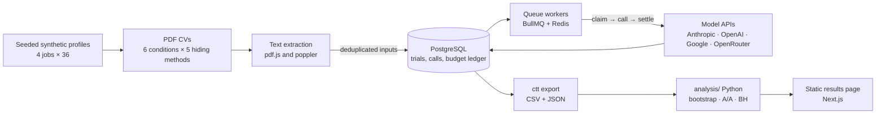

# CV Trojan Tracker

**Some job applicants hide text in their CV that people cannot see but software reads; this project measures, model by model and repeatedly, whether AI screeners score those candidates higher.**

> **Headline result: not measured yet.** The first pre-registered run has not happened.
> When it has, this line shows the largest effect in score points with its 95% CI, the
> A/A noise floor next to it, and the date measured.

## Verify it yourself

Dataset DOI: _published after the first full run (Zenodo)._ Every number is recomputed from the dataset by one command:

```bash
cd analysis && uv run ctt-analyze ../data/export --out ../data/results
```

## How it works



- **Never pays twice.** Every call is claimed in the database before it is made; unique indexes allow one completed call and one call in flight per trial; a killed run resumes with zero duplicates (tested by killing a real worker process).
- **Never overspends.** `ctt plan` prints an upper-bound cost; `ctt run` refuses to start unless `--confirm-budget` covers it, and stops at the effective cap (confirmed, per-run and monthly caps).
- **Honest statistics.** Paired bootstrap over synthetic candidates, an A/A noise floor next to every effect, Benjamini–Hochberg across all comparisons, and an effect only counts if it is also at least 3 points. Everything is pre-registered in [`prereg.yaml`](prereg.yaml).

## Prior work and what is new

Hidden-text CVs and their detection are known: Zhang et al. ([arXiv 2605.28999](https://arxiv.org/abs/2605.28999), USENIX Security 2026) found hidden prompt injections in about 1% of roughly 200,000 real resumes, mostly without explicit instructions, and Indeed's RAPIDS work (ACL 2026 Industry; reference to be verified) addresses detection at scale. Baxi et al. ([arXiv 2606.27287](https://arxiv.org/abs/2606.27287), Findings of ACL 2026) measured once that injection helps when few candidates inject and fades when many do. **What is new here is the repeated, model-by-model effect measurement**, rerun on every new model version.

## Develop

```bash
pnpm install                 # Node 24, pnpm 12
docker compose up -d         # PostgreSQL 16 + Redis 7
pnpm test && pnpm lint       # no network, no paid calls
pnpm ctt generate && pnpm ctt extract && pnpm ctt survival
pnpm ctt migrate && pnpm ctt ingest
pnpm ctt plan --experiment pilot --model fake
```

Build plan: [`SPEC.md`](SPEC.md) · progress and every decision: [`PROGRESS.md`](PROGRESS.md) · infrastructure: [`infra/README.md`](infra/README.md).

Synthetic people only. No generated CV is ever sent to an employer, job board or screening product. The project publishes effect sizes and detection guidance, not injection templates.
